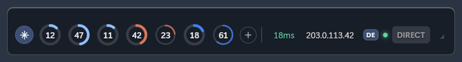
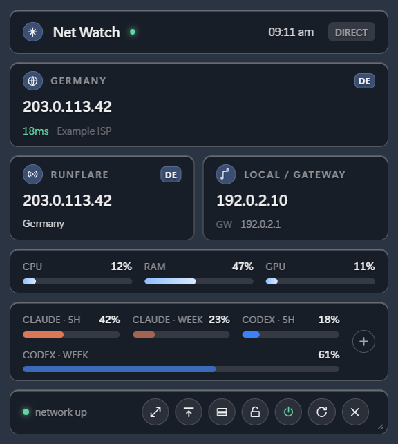
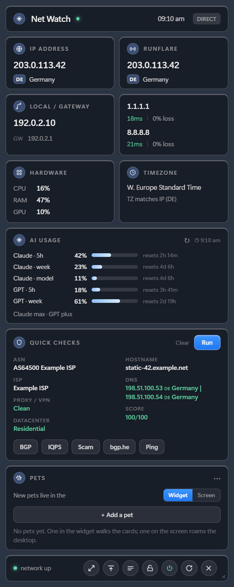

# net-watch-widget

An always-on-top desktop widget for Windows that answers, at a glance:
**am I on the VPN, is the connection healthy, and how much of my AI plan is
left?**

Python gathers the data, React draws it. One PowerShell command to install.
Starts automatically with Windows and stays out of the way.

It has three views of the same data, and you move between them with a click:

**Mini bar** — a tab docked to an edge of the screen:



<table>
  <tr>
    <th>Compact</th>
    <th>Full</th>
  </tr>
  <tr>
    <td valign="top"></td>
    <td valign="top"></td>
  </tr>
</table>

---

## Contents

- [What it shows](#what-it-shows)
- [Requirements](#requirements)
- [Install](#install)
- [Using it](#using-it)
- [Pets](#pets)
- [Configuration](#configuration)
- [AI usage tracking](#ai-usage-tracking)
- [Multiple AI accounts](#multiple-ai-accounts)
- [Restarting after an edit](#restarting-after-an-edit)
- [Uninstall](#uninstall)
- [Troubleshooting](#troubleshooting)
- [Privacy and security](#privacy-and-security)
- [How it works](#how-it-works)
- [License](#license)

---

## What it shows

**Mini bar** — a tab docked to an edge of the screen, out of the way of
everything: a dial each for CPU, RAM and GPU, a dial for each AI you have chosen
to show, the ping, your public IP with its exit country beside it, the adapter
dot and the VPN chip. It sits on the top, bottom, left or right edge — a row on
the top and bottom, a column down a side — at either end of that edge or in the
middle of it. Click it to open the widget; drag it to move it, including onto a
different edge. Nothing is labelled at this size — hover a dial for its name —
because the point of it is to be glanceable, not readable.

The CPU, RAM and GPU dials are always there, showing a dash until they have a
reading. The AI dials are your choice — none at first, added with the round
**+** — so the tab is as long as what you asked it to show. See
[Choosing which AI usage to show](#choosing-which-ai-usage-to-show). It is the
mode the widget reopens in if it was the mode you left it in.

**Compact mode** — a short summary. A title row with the clock and the VPN
chip; a card with the exit country, public IP, ping and ISP; the Runflare
address and the local address / gateway side by side; CPU / RAM / GPU bars; and
bars for the AIs you have chosen, the same choice as the mini bar.

**Full mode** — everything above plus:

| Section | Contents |
|---|---|
| Network | public IP and the Runflare address, each with its country; local IP and gateway |
| Latency | round-trip time and packet loss to two hosts |
| Hardware | CPU, RAM, GPU |
| Timezone | system timezone against the timezone of your exit IP |
| AI usage | every AI account you have added, with quota percentages and reset countdowns — see [Multiple AI accounts](#multiple-ai-accounts) |
| Quick checks | ASN, ISP, proxy/VPN and datacenter detection, hostname, DNS, a connection score |
| Pets | the roster and settings for the optional pets |

The title row in compact and full mode carries the local clock, a second clock
on Tehran time (`THR`), and the VPN chip — `VPN`, `Direct`, or a dash until the
first pair of IP lookups is in.

The VPN indicator is not a guess from the IP alone: it cross-checks the
country reported by a geo-IP lookup against Cloudflare's own edge report, and
flags a mismatch between the two rather than trusting either one.

**A changed exit address turns its card red.** If either the public IP or the
Runflare address moves, that card gets a red border and pulses three times, then
holds the red for a minute — long enough to still be there when you next glance
over. Hover it to see what the address was before. Only a move between two real
addresses counts: a failed lookup is not a move, so a network hiccup will not
cry wolf.

**Pets**, if you want them — pixel animals that either walk the tops of the
cards and hop between them, or leave the widget and roam the desktop. Off until
you add one. See [Pets](#pets).

---

## Requirements

- Windows 10 or 11
- Python 3.9 or newer from [python.org](https://www.python.org/downloads/)
  (tick **Add python.exe to PATH** during setup)
- Node.js 20 or newer from [nodejs.org](https://nodejs.org)
- One Python dependency, `psutil`, which the installer installs for you

`tkinter` is **not** required. Nothing here imports a Python GUI toolkit.

You do **not** need an API key, an account, or an internet-facing service.

---

## Install

```powershell
git clone https://github.com/shawnbhs/net-watch-widget.git
cd net-watch-widget
powershell -ExecutionPolicy Bypass -File .\install.ps1
```

That single command:

1. verifies Python and Node are present,
2. pins the Python it found in a user environment variable,
   `NET_WATCH_PYTHON`, so the app starts its data process with that
   interpreter and not whichever `pythonw.exe` happens to be first on `PATH`,
3. installs `psutil` if it is missing,
4. installs the UI's dependencies and builds it — the first run downloads
   Electron, about 100 MB; if npm blocked Electron's own download script, the
   installer runs it itself,
5. creates `.env` from `.env.example` (all settings optional),
6. registers the widget to start automatically at login,
7. starts it.

Re-running it is safe — it rebuilds the UI, updates the autostart entry and
leaves an existing `.env` alone.

To set it up without autostart:

```powershell
powershell -ExecutionPolicy Bypass -File .\install.ps1 -NoAutostart
```

### Why `-ExecutionPolicy Bypass`

Windows blocks unsigned scripts by default. The flag applies to this one
invocation only and changes nothing system-wide. Read `install.ps1` first if
you would rather not take that on faith — it is under 300 lines, most of them
comments, and does exactly what the list above says.

---

## Using it

- **Drag the title bar** to move it. Position is remembered.
- **Drag the bottom-right corner** to resize it — the whole widget scales, text
  and all. Double-click that corner to go back to normal size.
- **Right-click anywhere** to switch between compact and full. On the mini
  bar, right-click opens the widget.
- **Click a readout** — either IP, the local address, the gateway, a latency
  figure — to copy it.

The footer starts with the adapter dot and its state (*network up*,
*network cut*, *working…*). The buttons after it, left to right: resize, mini
bar, compact/full, lock position, network toggle, refresh, quit. Hover any of
them for a tooltip; the stateful ones name the action they will perform, so the
network button reads "Cut network" while you are connected and "Restore
network" while you are not.

### Resizing it

The grip in the bottom-right corner scales the entire widget — type, icons,
bars, the lot — rather than stretching the panels, because the layout is a
fixed-width column of hand-picked type sizes and a wider one would only leave
small text stranded in the middle of big panels. Double-click the grip to
return to 100%. The size is remembered, and the mini bar inherits it.

The corner is a small target, so the **resize** button in the footer opens a
full-width bar that does the same thing: drag anywhere along it, and it shows
the current size and how large this screen allows. The mini bar has its own
small grip at the end of the tab, with the same drag and the same double-click
reset.

It grows as large as the current screen can hold, and shrinks to 35%. Below
92% the frosted panels are switched off and the cards are drawn without them:
each frosted panel is a separate window, Windows will not make a window
shorter than 39 pixels, and below that point the frost behind the thinnest
cards would stand proud of them.

### The mini bar

The ↑ button collapses the widget to a tab on the edge of the screen.
**Click the tab** to open it again — it returns to wherever you had dragged the
widget, not to the edge. Locking the position stops the drag but not the click.

**Drag the tab** to move it. Letting go parks it on the nearest of twelve
docks: the top, bottom, left or right edge, at the start, the middle or the end
of it. It changes shape to suit — a row along the top or bottom, a column down a
side — and it can be carried to another monitor on the way. On the bottom edge
the tab sits on top of the taskbar, never over it.

**Click the IP on the tab** to copy it; the digits change colour briefly to say
it worked. A drag that starts on the IP still moves the tab, and a click
anywhere else on the tab still opens the widget. If the exit address changes,
the tab turns red the same way the IP card does.

The tab deliberately overhangs its edge by a few pixels. Windows rounds the
corners of the frosted panel behind it and gives no way to ask for square ones,
so the overhang is what puts that rounding out of sight and lets the tab meet
the edge cleanly.

### Choosing which AI usage to show

The mini bar and the compact view show no AI usage until you pick it, because
which plans matter is yours to say, and an unused account's dial is only noise.
Compact says so: *"Press + to choose which AI usage to show"*.

The round **+** opens a list of every AI that has an account in the widget —
see [Multiple AI accounts](#multiple-ai-accounts) for adding one. While it is
open the tab grows to hold it, and the **+** turns into **×**.

- Tick an AI to show its current usage window (the 5-hour one, for Claude and
  Codex).
- Tick **week** beside it to add that AI's weekly window as well. On the mini
  bar it is a second, thinner ring; in compact it is a second, lighter bar.
- Nothing changes until you press the blue **Save** in the box. **Cancel**, the
  **×**, or Escape closes it and throws the ticks away, so browsing the list
  never changes what is shown.

The choice is shared: the mini bar and compact view always show the same AIs.
It is kept in the UI's own local storage, so it survives a restart, and the
data process never sees it.

Each AI is drawn in its own brand colour — Claude orange, Codex blue, the
others their own — and the ring or bar keeps that colour at any level, so you
can always tell which AI it is. The warning goes on the number instead: it turns
amber from 70% and red from 90%.

### Full-screen apps

The widget stays above every normal window, and is put back on top whenever
another window takes the foreground, so a window opened later cannot bury it.

The one exception is a full-screen app on the same monitor: a game, a
full-screen video player, a browser in F11 or a YouTube video in full screen,
a terminal in F11. While that window is in front the widget hides; alt+tab,
Esc or F11 again brings it straight back. A maximised window with a title bar
does not count. Full screen on another monitor does not hide it either, and
neither does Windows' own alt+tab or Task View screen. To avoid flicker while a
window resizes into full screen, it hides only after the full screen has held
for 0.7 s, and comes back 0.25 s after you switch to another window (1.2 s
when the same window just leaves full screen). Set
`NET_WATCH_FULLSCREEN_HIDE=0` to keep it visible always.

### Diagnostic log

The shell keeps one day of events in
`%APPDATA%\net-watch-ui\logs\net-watch.log`: start and quit, errors, sleep,
wake, lock, monitors added or removed, the widget being moved back on screen,
Show desktop, and every full-screen hide and show. Read it when the widget
went missing.

The day starts at 05:30. At that time the file becomes
`net-watch.yesterday.log`, replacing the previous one, and a new file starts,
so there are never more than two days on disk. If the laptop was off or
asleep at 05:30, the cut happens the first moment the widget runs again:
start-up, wake, unlock, or the next write. A day is capped at 8 MB.
`NET_WATCH_LOG_ROTATE=HH:MM` moves the cut.

### Quick checks and AI usage

**Quick checks** fill themselves in a second or two after launch, and again
whenever your public IP changes. **Run** re-runs them on demand and **Clear**
blanks them. The five pills below open that IP in an external lookup.

Hover any usage figure -- a ring on the tab, a meter in the compact view or a
row in the full view -- for the same line: provider, window, percent used and
how long until it refills, e.g. `Claude Code · week · 32% · resets in 4d 12h`.

**AI usage** polls each provider on its own schedule: Codex every 60 seconds,
Claude every 3 minutes, every other provider every 5 minutes. The ↻ beside the
heading forces a poll, at most once every 30 seconds, and never while a
provider has told the widget to back off. See
[AI usage polling](#ai-usage-polling) for the settings.

### The network button

The power button cuts your connection: it disables every physical network adapter,
wired **and** wireless. Click it again to bring them back. The dot is green
while connected, red while cut, and amber for the couple of seconds a toggle is
in flight.

Each toggle raises **one UAC prompt**, because disabling an adapter needs
administrator rights and the widget deliberately runs as a normal user rather
than asking you to run the whole thing elevated. Declining the prompt is a
no-op — the network is left exactly as it was.

Virtual adapters are left alone: hypervisor switches (disabling one takes your
VMs and containers offline with it) and VPN tunnel adapters (their client owns
them). See `NET_SKIP` in `.env.example` to adjust the exclusions.

If the adapters ever stay down — a crash mid-toggle, a declined restore — this
puts them back from an **Administrator** PowerShell:

```powershell
Get-NetAdapter | Where-Object { -not $_.Virtual } | Enable-NetAdapter -Confirm:$false
netsh wlan set autoconfig enabled=yes interface="Wi-Fi"
```

The second line matters more than it looks. `netsh wlan set autoconfig
enabled=no` is the other common way to cut Wi-Fi, it survives a reboot, and it
stops the interface associating even after the adapter is enabled again — an
adapter that reads *Up* but will not connect. The widget clears it on every
restore, so you only need this if you are recovering by hand.

---

## Pets

The widget keeps pixel pets. They are optional, off until you add one, and they
come in two kinds.

Open the **Pets** card at the bottom of the full view. **+ Add a pet** shows
every species in the catalogue — **25** of them as shipped — as a grid of
thumbnails; pick one, pick a colour if it has several, optionally type a name,
and it drops in from above onto whatever card is underneath. Each pet gets a row
of its own with a **Widget / Screen** switch:

- **Widget** — it lives on the widget. It walks the top edge of a card, hops
  between cards, and stands about on them. Its body reaches up over the card
  above, so a pet crossing the panel will briefly pass in front of a readout.
  That is the trade: the cards are 8px apart and there is nowhere else for it to
  be. The topmost card is the ceiling and nothing stands on it, because there is
  no window left above it to draw a pet in.
- **Screen** — it leaves the widget and roams your desktop, walking and hopping
  wherever it likes and resting just above the taskbar. This opens a second,
  transparent, click-through window spanning **every display you have** — its
  rectangle is the union of all of them, and each screen contributes its own
  floor at the bottom of that screen's work area, so a pet rests on the top edge
  of the taskbar rather than over the clock. The window exists only while at
  least one pet is out there and closes itself when the last one comes home, so
  an empty desktop costs nothing. Add or unplug a monitor and the overlay
  re-measures itself.

The **New pets live in the** switch at the top of the card sets which of the two
a newly added pet starts in. Nothing stops you having some of each.

**Turning them off** is the same control as turning them on: there is no master
switch, only the roster. Remove a pet with the **✕** on its row, or use **Clear**
in the card header to remove every one of them at once. With no pets left the
animation loop parks itself rather than idling — nothing is being drawn and
nothing is being computed — and the desktop overlay window closes. The roster and
the settings are stored in the widget's own local storage and come back the next
time you start it.

### Handling them

| Gesture | What happens |
|---|---|
| Click a pet | Poke it |
| Drag a pet | Pick it up; let go and it falls, keeping the throw |
| Double-click a pet | Send it across — widget to desktop, or desktop back to the widget |
| Right-click a widget pet | Hop it up one card |
| Scroll over a widget pet | Move it up or down between cards |
| Right-click a desktop pet | Tell it to follow your cursor, or to stop |

Everything a gesture does has a button equivalent in the card, so nothing is
drag-only.

### Settings

The **⋯** button in the card's header opens the tuning, which applies to every
pet at once:

| Control | Range | What it does |
|---|---|---|
| Size · all pets | 16–100 px | Drawn height before the widget's own scale; the default is 26 px |
| Size · this screen | 0.5x–2x | Desktop pets on the monitor the widget is on, only — see below |
| Speed | 0.2x–2.5x | How fast they move |
| Liveliness | 0–100 | How much they move about versus lie down — *lazy*, *balanced*, *hyper* |
| React to the cursor | on/off | Pets notice the pointer and sometimes chase it |
| Dance breaks | on/off | A pet stops where it is and has a shake |
| Contact shadows | on/off | A soft shadow under each pet |
| Reduced motion | on/off | Stops the wandering and keeps the pets still |

Two things are per pet rather than global: the **Widget / Screen** switch, and
what you get by clicking a pet's name in the roster — a **rename** field and a
**size multiplier** from 0.1x to 8x that rides on top of the global size, so one
pet can be made big without dragging everyone else up with it. The slider shows
both the multiplier and the pixel height it works out to.

**Size · this screen** exists because "the same size" is not the same thing on
every monitor. Desktop pets are already held at the same physical size on every
screen, but a monitor at arm's length looks smaller than a laptop panel close
to you, and the widget cannot measure how far away you sit. So each monitor
keeps its own adjustment, remembered per monitor even if you unplug it; **Reset**
forgets this screen's, and **Reset all screens** forgets every one. It does not
touch pets living on the widget, which are not sized against a screen at all.

Pets on the desktop are drawn about **1.7x** larger than the same figure in the
widget, because a sprite sized to stand on a 43px-tall card is barely visible
against a whole screen.

A widget pet's body reaches *up* from its feet, so the size slider running to
100 px is deliberate even though a widget card cannot show a pet that tall: the
ceiling is there for the desktop half of the roster, which has a whole screen
over its head.

Pets are hidden while the widget is collapsed to its mini bar: a tab is a single
card, and with the topmost one reserved as the ceiling there is no ground left
in it. Pets out on the desktop carry on regardless.

### The hero pack

One species, **Hero**, is not third-party art: its twelve superheroes are drawn
from scratch by `app/tools/make_heroes.py` as parametric pixel art — a shared
chibi body rig posed frame by frame, plus a palette and three silhouette
switches per character (cape, head, build). They carry no third-party licence,
and adding a thirteenth is an entry in the `HEROES` table and a re-run.

| | Palette | Head | Build | Cape |
|---|---|---|---|---|
| crimson | red / gold | helmet | normal | — |
| verdant | green / navy | bare | bulky | — |
| midnight | indigo / deep blue | cowl | normal | yes |
| frost | white / ice blue | helmet | slim | yes |
| ember | orange / rust | domino | normal | — |
| violet | purple / pink | domino | slim | yes |
| onyx | slate / silver | cowl | bulky | yes |
| solar | gold / cream | visor | normal | yes |
| abyss | deep teal / aqua | helmet | slim | — |
| sable | charcoal / olive | hood | slim | — |
| bronze | copper / teal | hood | bulky | yes |
| vermeil | magenta / warm gold | visor | normal | yes |

**Marvel, DC and other licensed characters are not included and cannot be.** No
sprite set for them exists under a licence that permits redistribution — what
circulates online is unlicensed fan art, and this repository is public and MIT,
so bundling it would pass the problem to everyone who clones it. The hero pack
is here to scratch that itch honestly. If you own a pack you are entitled to
use, the next section is all it takes to add it.

### Adding your own sprites

The species list is not hard-coded anywhere. It is built by scanning
`app/assets/pets/` at startup — 25 folders as shipped, each one a species, each
file inside it a `<colour>_<action>_8fps.gif` clip — so adding a folder of clips
there is enough to add a species, with no code change. Re-measure them
afterwards, or the pet will resize as it changes animation:

```powershell
pip install Pillow
python app/tools/gen-metrics.py
```

---

## Configuration

Everything is optional. **The widget runs correctly with no configuration at
all** — copy `.env.example` to `.env` only if you want to change something.

| Key | Default | What it does |
|---|---|---|
| `CLAUDE_CRED_PATHS` | `%USERPROFILE%\.claude\.credentials.json` | Where to find the Claude CLI's stored login |
| `CODEX_CRED_PATHS` | `%USERPROFILE%\.codex\auth.json` | Where to find the Codex CLI's stored login |
| `AI_ACCOUNTS_FILE` | `%APPDATA%\net-watch-ui\accounts.json` | The account vault — see [Multiple AI accounts](#multiple-ai-accounts) |
| `PING_HOST_1` | `1.1.1.1` | First latency target |
| `PING_HOST_2` | `8.8.8.8` | Second latency target |
| `LOG_FILE` | `%USERPROFILE%\ip_bar_log.txt` | Where the log is written |

Both credential keys accept several paths separated by `;`. Order does not
decide the winner: every readable path is read and the copy whose token
expires latest is used, so listing a stale leftover beside a live one is
harmless. `~` and `%VARIABLES%` are expanded.

The table above is the short list. **[`.env.example`](.env.example) is the
authoritative one** — it carries every key the widget reads, including the
`AI_LOGIN_*` keys that control how a sign-in is launched, each with its default
and a note on what it is for. Read it there rather than here; it is kept current
and this table is not repeated.

Restart the widget after editing `.env`; it is read once at startup.

---

## AI usage tracking

If you use the **Claude Code** or **OpenAI Codex** CLI, the widget shows how
much of your plan you have used, with a countdown to each reset.

It works by reading the OAuth token those CLIs already saved when you logged
in. There is no API key to paste, and the widget never sees your password.

**If you have not logged in to either CLI, the widget still works perfectly** —
the AI rows show `setup` and the note line reads *"please run 'claude' and log
in"*. Everything else keeps running. Nothing is polled, so there is no wasted
network traffic and no error spam in the log.

To enable it, log in to whichever CLI you use:

```powershell
claude    # then follow the login prompt
codex     # then follow the login prompt
```

The widget picks the credentials up on its next poll (within 60 seconds for
Codex, 3 minutes for Claude), or immediately if you hit **Refresh**.

### If you run the CLIs inside WSL

The tokens then live in your Linux home, not your Windows profile. Point the
widget at them in `.env`, replacing the distro and username:

```ini
CLAUDE_CRED_PATHS=\\wsl.localhost\Ubuntu\home\youruser\.claude\.credentials.json
CODEX_CRED_PATHS=\\wsl.localhost\Ubuntu\home\youruser\.codex\auth.json
```

### Staying logged in

Tokens are refreshed an hour before they expire, on a timer that runs whether
or not the usage panel is polling. Without that, a token could quietly lapse
during a long stretch with the machine off or the network down, turning a
background refresh into a manual re-login.

If a login does expire, the note line becomes **"login expired — click to sign
in"**. Clicking opens a console running the CLI's own login. The sign-in itself
is a browser round-trip — the widget cannot and does not automate it, and it
never handles your password. If the CLIs are not on your Windows PATH, set
`AI_LOGIN_CMD_CLAUDE` / `AI_LOGIN_CMD_CODEX` in `.env`.

### "credentials stale" vs "login expired"

These mean different things, and the difference matters when the same account
is stored in more than one place — a Windows profile *and* a WSL home, say.

The widget uses whichever copy expires latest. If the fresh copy becomes
unreadable (the WSL distro is stopped, a share is unmounted), only the old copy
is left, and refreshing from its long-dead token would fail. Rather than report
that as an expired login and send you off to redo a sign-in that was never
broken, copies older than the 16-day refresh-token lifetime are ignored and the
panel says **`credentials stale`** — meaning *the good file is out of reach*,
not *your login died*.

---

## Multiple AI accounts

Coding-assistant CLIs generally hold **one login at a time**. Sign in to a
second Claude account and the first one is gone from `.claude` — not expired,
just overwritten. If you keep a personal plan and a work plan, or two plans on
different rate limits, you cannot see both at once.

The widget keeps its own copy. Every account you register gets its own entry
in a file the widget owns, credential included, so several accounts of the same
vendor sit side by side and every one of them is polled. Signing in to the CLI
again changes what the CLI holds; it does not disturb what the widget already
stored.

The AI card becomes two panes: the account list on the left, with a search box
above it, and the selected account's quota on the right. Accounts are renameable
— `work`, `personal` — because the credential files carry no display name to
borrow, so a fresh import is called `Claude Code`, `Claude Code 2` and so on
until you say otherwise.

### Adding an account

**On first run, nothing.** Whatever the `claude` and `codex` CLIs already have
on disk is imported automatically, once, at the first launch after upgrading —
including copies in a WSL home if `CLAUDE_CRED_PATHS` / `CODEX_CRED_PATHS`
point at them. Duplicates of the same login are folded together rather than
listed twice.

That import happens **once**. The widget records that it ran, so an account you
delete on purpose stays deleted instead of reappearing at the next launch, and
a later CLI login does not quietly overwrite the copy the widget has since
refreshed.

**Afterwards, the `+` button** beside the search box. It opens a searchable list
of every registered provider, with the ones that cannot report usage yet greyed
out and labelled as such. Pick a working provider and the widget opens that
CLI's own sign-in in a console. The sign-in is a browser round-trip belonging to
the vendor — the widget cannot automate it and never handles your password. When
it finishes, the new credential is stored as its own account.

That console is **not** your normal shell. Each sign-in is launched into a
disposable sandbox directory that acts as a fake home: `HOME`, `USERPROFILE`,
`HOMEDRIVE`/`HOMEPATH` and the `XDG_*` directories are all pointed inside it, and
the CLI's own config variable (`CLAUDE_CONFIG_DIR`, `CODEX_HOME`) with them, so
the CLI finds no previous login to reuse and is forced to actually ask. Proxy and
API-key variables — `ANTHROPIC_BASE_URL`, `ANTHROPIC_AUTH_TOKEN`,
`ANTHROPIC_API_KEY`, `CLAUDE_CODE_OAUTH_TOKEN` for Claude, `OPENAI_API_KEY` and
`OPENAI_BASE_URL` for Codex — are unset for that one child process only, because
a CLI that thinks it is already authenticated turns the whole login into a silent
no-op. The sandbox is created under your temp directory, refuses to be created
anywhere near a real home or config directory, and is shredded and deleted the
moment the credential has been copied into the vault. Nothing outside it is
touched, and your own logins are left exactly as they were.

Only one sign-in runs at a time. A second is refused rather than queued — two
consoles waiting for one person is not something to spread across two sandboxes.

The same **sign in** action is offered on an individual account whose login has
genuinely expired, so you re-authenticate just that one and leave the others
alone.

### Read this before adding a second account

**The sandbox fixes the CLI. It cannot fix your browser, and your browser is
what decides which account you end up connected as.**

An OAuth sign-in happens in your normal web browser, which the widget does not
own and has no way to isolate. If you are still signed in to the provider's
website as your first account, the handshake completes as *that* account
immediately, without ever showing you a login form or asking which account you
want. You will think you added the second one. You did not. There is no code
change that fixes this — the credential the CLI hands back is a genuine, correct
credential for the account your browser was already signed in as.

So, **before** you start a second sign-in, do one of these:

- sign out of the provider's website in your browser, or
- open a private / incognito window and sign in to the provider there first, or
- use a separate browser profile for the second account.

Then run the widget's sign-in and complete it in that session.

The widget checks the result rather than trusting it. If the credential that
comes back belongs to an account you already have, the sign-in is **refused** and
nothing is written to the vault — you get the message *"This is the same account
you are already signed in as. Sign out in your browser, or open a
private/incognito window, before signing in with the other email address."*
Re-authenticating an existing account is checked the same way, and a sign-in that
comes back as a *different* account is refused too, with *"That sign-in came back
as a different account, not this one, so nothing was changed."* That second
refusal matters: both providers kill the old refresh token the instant they issue
a new one, so writing the wrong credential into a row would have destroyed the
very account you were trying to repair.

### Which providers work today

Twelve vendors are registered. **Two of them work end to end today: Claude
Code and Codex.** The widget can sign them in, import them, and poll them.

Six more have a usage reader in the code but no way in yet. The widget's
sign-in only knows how to drive the Claude and Codex CLIs, and the startup
import only reads those two. These six are greyed out in the picker and
labelled *sign-in not available yet*, so they cannot be picked into a sign-in
that would only fail. The last four are greyed out, labelled *not wired up
yet*, and never polled.

| Provider | Usage today |
|---|---|
| Claude Code | **Working** — sign-in, import, quota and reset countdown |
| OpenAI Codex / ChatGPT | **Working** — sign-in, import, quota and reset countdown |
| Cursor | Usage reader written; the widget cannot add the account yet |
| GitHub Copilot | Usage reader written; the widget cannot add the account yet |
| Windsurf | Usage reader written; the widget cannot add the account yet |
| Devin | Usage reader written; the widget cannot add the account yet |
| Kimi Code | Usage reader written; the widget cannot add the account yet |
| Cline | Usage reader written; the widget cannot add the account yet |
| Replit | Planned — the usage API is Enterprise/admin-only |
| GLM Coding Plan | Planned — response fields not verified |
| Google Antigravity | Planned — response shape and Windows credential path unknown |
| Railway | Planned — consumption billing, no quota window |

If you only want numbers on the screen, register Claude Code and Codex accounts
and ignore the rest of the list. A planned provider saying *not supported yet*
is the intended behaviour, not a fault to report: the alternative was inventing
a percentage, and a made-up quota is worse than an honest blank.

### When an account shows a problem

Three failures look similar in a small panel and mean completely different
things, so the widget keeps them apart rather than showing one generic warning.

| What it says | What it means | What to do |
|---|---|---|
| `login expired` | The provider rejected the stored credential outright — it is genuinely dead | Sign in again on that account |
| `offline` | The request never reached the provider — no network, DNS failure, a timeout | **Nothing.** Wait, or fix the connection |
| `refresh failed · <code>` | The provider answered, with an error of its own | Usually transient — retry later; the status code is shown so you can look it up |

**`offline` says nothing at all about your login.** It is the state the widget
reports when it could not ask the question, and the credential is untouched
underneath it. Treating that as an expired session — and being sent off to redo
an OAuth sign-in that was never broken — is the exact bug this design exists to
prevent, so an offline account never arms the sign-in click.

A re-login is genuinely needed in one case: the credential is **past the refresh
window**. Both live providers rotate their refresh token every time it is used,
and a stored copy older than roughly **16 days** can no longer be exchanged for
a fresh token no matter what. That one can only be fixed by signing in again.
Everything else is worth waiting out first.

Because those tokens rotate, the widget rewrites the stored credential as they
roll. That is normal — the file changing under you is the refresh working.

### Where the accounts are stored

| | |
|---|---|
| Default | `%APPDATA%\net-watch-ui\accounts.json` |
| Override | `AI_ACCOUNTS_FILE` in `.env` |

**This file holds live credentials.** It is created with owner-only permissions,
written atomically, and the permissions are set as the file is created rather
than tightened afterwards, so it is never briefly readable by anyone else. Treat
it like any other secret: do not sync it to a shared folder, do not paste it
into an issue, and delete it if you are handing the machine on.

`%APPDATA%` is the roaming profile, which is deliberate — the file is small, it
is per-user configuration, and a roaming profile ought to bring your account
list with it. Set `AI_ACCOUNTS_FILE` to move it somewhere else, an encrypted
volume for instance. `~` and `%VARIABLES%` are expanded.

It is plain JSON. Deleting it loses nothing but the account list and the names
you gave them; the CLIs' own logins are untouched and can be imported again.

**Deleting an account stays deleted.** Removing a row does two things: it drops
the entry from the vault, and it writes a small record of the removal to a
separate file beside the vault — `accounts.json.forgotten` by default, and it
follows `AI_ACCOUNTS_FILE` if you move the vault. That record is what stops the
CLI import from quietly putting the account straight back the next time it finds
the same credential file on disk. It lives outside the vault on purpose: deleting
or resetting `accounts.json` — an uninstall, a reinstall, a corrupted-vault
recovery — would otherwise un-delete every account you had ever removed. The
record holds no secret, only which provider it was, a fingerprint, the path the
credential was read from, and when you removed it.

The trade-off is stated plainly in the code and worth knowing: a removal is also
matched on the *file path* the credential came from, not only on its contents,
because Claude's fingerprint changes every time its token is refreshed. So if you
later log that same CLI in as a genuinely different account, the import will keep
skipping that file until you allow it back. A removal that was too enthusiastic
costs you one re-import; an account resurrecting itself costs you trust that
delete means delete.

### Troubleshooting accounts

**The same account appears twice, and one copy is wrong.**
This is the classic one: a login exists both in your Windows profile and in a
WSL home, and the older of the two is a leftover. Imports fold identical logins
together, but two genuinely different stored copies are two accounts. Delete the
stale one from the list — nothing else in the vault is affected.

**I signed in, and it added the account I already had.**
This is the browser, not the widget, and it is the single most common way to
lose an afternoon here. Your browser was still signed in to the provider as the
first account, so the OAuth handshake completed as that account without asking.
The widget detects it and refuses the write, so nothing was damaged — but the
second account was never added. Sign out at the provider's website, or use a
private window, and run the sign-in again. See
[Read this before adding a second account](#read-this-before-adding-a-second-account).

**A removed account will not come back when I want it to.**
Removals are durable on purpose — see
[Where the accounts are stored](#where-the-accounts-are-stored). The record of
the removal sits in `accounts.json.forgotten` beside the vault, and the import
keeps skipping that credential until the record is cleared.

**Every account reads `offline` (or `VPN required`) and the network is fine.**
The providers block some regions outright, and the widget will not send a quota
request at all when it cannot confirm the exit IP is outside a blocked one. That
gate is deliberate: no request goes out, so there is nothing to retry and
nothing is wrong with your stored logins. Connect your VPN and hit Refresh. See
also [Troubleshooting](#troubleshooting).

**An account will not import.**
The credential file has to be readable at the moment the widget looks. A stopped
WSL distro or an unmounted share is the usual reason — start it and restart the
widget, and the import is retried.

---

## Restarting after an edit

Editing a file on disk does **not** change the running widget.

Python only — `core.py` or `sidecar.py`:

```powershell
powershell -ExecutionPolicy Bypass -File .\install.ps1
```

UI only — anything under `app/src`:

```powershell
cd app
npm run build
npm start
```

`npm start` clears `ELECTRON_RUN_AS_NODE` before launching. Some terminals
export it, and inherited it makes `electron.exe` behave as a plain Node binary:
the app dies on `app is undefined`, with a stack trace that points nowhere near
the cause.

---

## Uninstall

```powershell
powershell -ExecutionPolicy Bypass -File .\install.ps1 -Uninstall
```

Stops the widget and removes the autostart entry and the `NET_WATCH_PYTHON`
setting. Delete the folder to remove the files, and `%USERPROFILE%\ip_bar_log.txt` for the log.

The log keeps its old name so an existing history is not orphaned; `LOG_FILE`
in `.env` moves it.

---

## Troubleshooting

**Nothing appears after install.**
Run it in a console to see the error:

```powershell
cd app
npm start
```

**"Python was not found"** — Python is not on `PATH`. Reinstall from
python.org with **Add python.exe to PATH** ticked, or open a new terminal if
you just installed it.

**AI rows say `setup`.** That is the expected state before you log in to the
Claude or Codex CLI. See [AI usage tracking](#ai-usage-tracking).

**AI rows say `err`.** A real failure, not a missing login. Check `Open Log`.
The usual cause is an expired refresh token — logging in to the CLI again
fixes it.

**The mini bar or compact view shows no AI usage.** Nothing is shown until you
choose it. Press the round **+**, tick the AIs you want, then **Save**. An AI
appears in that list only once it has an account. See
[Choosing which AI usage to show](#choosing-which-ai-usage-to-show).

**AI rows say `VPN required`.** The AI providers block some regions, so the
widget refuses to send a request when it cannot confirm the exit IP is
outside a blocked one. Connect your VPN and hit Refresh.

**The widget does not start after a reboot.** Check the autostart entry
survived:

```powershell
Get-ItemProperty 'HKCU:\Software\Microsoft\Windows\CurrentVersion\Run' -Name NetWatch
```

If it is missing or the path is wrong, re-run `install.ps1`.

**Ping shows nothing.** Some networks block ICMP. Point `PING_HOST_1` at your
own gateway instead. The latency card names whichever hosts you set.

---

## Privacy and security

- **No telemetry.** Nothing about you is sent anywhere except the public API
  requests listed below, all of which you can see in the source.
- **No secrets in this repo.** `.env` is git-ignored, and the widget has no
  API key of its own.
- **Tokens are never logged, copied, or transmitted anywhere except the
  provider's own token endpoint** — `platform.claude.com` and
  `auth.openai.com`. The log records IP changes only.
- **Outbound requests**, in full: `myip.wtf` and `ipwho.is` (public IP),
  `ip-api.com` and `ipinfo.io` (ISP/ASN enrichment), `api.runflare.com`
  (second-opinion IP), `cloudflare.com/cdn-cgi/trace` (independent country
  check), and the two AI usage endpoints when a CLI is logged in.
- Two enrichment endpoints are plain HTTP because their free tier offers no
  HTTPS. They receive only a public IP address — never a credential — and
  their answers feed display fields only.
- Every scheme is checked before a request is opened, so no code path can be
  turned into a local file read.
- CI runs `semgrep`, `bandit`, `pip-audit`, `ruff`, and a full-history
  `gitleaks` scan on every push.

---

## How it works

Two halves, and the split is along the seam that was always there.

| | |
|---|---|
| `core.py` | Everything the widget knows: the geo cross-check behind the VPN verdict, the AI token handling, the adapter toggle, the country tables. Imports no GUI toolkit. |
| `sidecar.py` | Runs those functions on a schedule and writes what they return to stdout as JSON lines. |
| `app/` | An Electron shell and a React + Tailwind page that reads that stream. |
| `chrome.py` | One Win32 call Electron does not expose. |
| `netfast.py` | Local link-state detection, used by `core.gateway()`. |
| `app/assets/pets/` | The sprite set, scanned at startup to build the species list. |

Data is gathered on background threads, so a slow lookup never freezes the UI;
each panel updates as its own answer arrives.

The AI usage panel polls each provider on its own schedule with ±10% jitter,
backs off exponentially on failure, and stops entirely — no retries — when a
provider signals a region block. The quick checks run on an IP change and on demand,
never on the network cycle: two of their three lookups are free-tier enrichment
endpoints, and the cycle runs every three seconds.

### AI usage polling

| Provider | Default | Floor | Setting |
|---|---|---|---|
| Codex | 60 s | 60 s | `AI_POLL_SECONDS` |
| Claude | 180 s | 120 s | `AI_POLL_SECONDS_CLAUDE` |
| Everything else | 300 s | 120 s | `AI_POLL_SECONDS_OTHER` |

Set these in `.env`. Values are clamped to the floor and to one hour. The ↻
button's floor is the larger of 30 s and the provider floor, so in practice
60 s for Codex and 120 s for Claude and everything else.

When a provider answers 429, the widget holds that account for the
`Retry-After` time or an exponential backoff, whichever is longer. A 403
challenge page holds it for an hour. Holds are saved to `AI_RL_FILE`
(`~/.ipbar_ai_ratelimit.json` by default), so they survive a restart. A new
hold never shortens an existing one, and ↻ does not override a hold.

- A 429 on any key holds every key of that provider for the same account,
  both the legacy CLI credentials file and the vault.
- Offline and transport failures are not rate limits. They add no backoff;
  the poll is just rescheduled.
- A dead login is held for an hour, and nothing at all is sent for it in that
  time. The card keeps saying the login expired and keeps its sign-in button.
  It does not say "rate limited", because a fresh sign-in is the one thing that
  fixes it. Signing in again lifts the hold at once; you do not wait out the
  hour.
- The geo check runs against the current IP before every batch of requests.
  One that fails switches the AI section off with its reason; the next one
  that passes switches it back on, without waiting for the next poll.
- A corrupt state file is kept as a `.corrupt` copy and never causes a burst
  of requests.

**Why not faster for Claude.** Claude's usage endpoint rate-limits per
account and answers 429 with `Retry-After: 0`, then keeps refusing
([anthropics/claude-code#30930](https://github.com/anthropics/claude-code/issues/30930),
still open). Measured: about 7 reads per 10 minutes (one a minute) gets 29% of
polls refused; 3–4 reads gets 1–2%. 180 s is about 3.3 reads per 10 minutes.

[`app/README.md`](app/README.md) covers the parts of the UI that are not
obvious — why the frost is a separate window per card, why the cards are 8px
round, what happens when you drag or switch modes, and how the pets find the
ground under them.

### It used to be tkinter

Until recently this was one 6,455-line file, `ip_bar.py`, holding both the data
and a hand-drawn tkinter interface: a signed-distance-field rasteriser for the
icons, hand-measured layout, and per-monitor scaling arithmetic. The interface
is gone. What it did is now done by flexbox and inline SVG, and `core.py` is
the half that was never UI-shaped to begin with.

---

## License

MIT — see [LICENSE](LICENSE).

The pet sprites come from [vscode-pets](https://github.com/tonybaloney/vscode-pets) (MIT). Per-artist
attribution is in [app/assets/pets/CREDITS.md](app/assets/pets/CREDITS.md).
